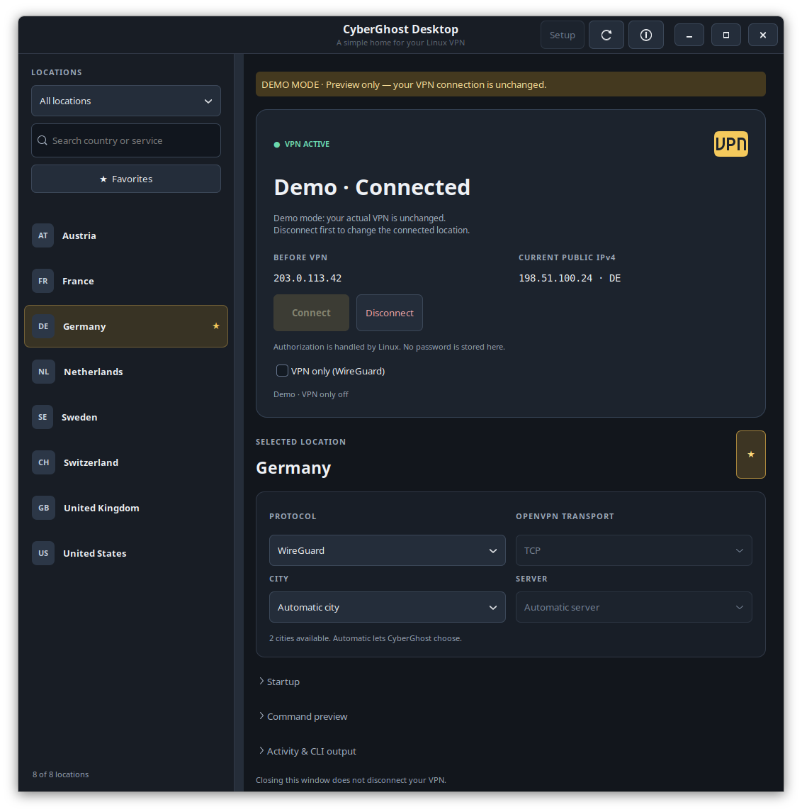
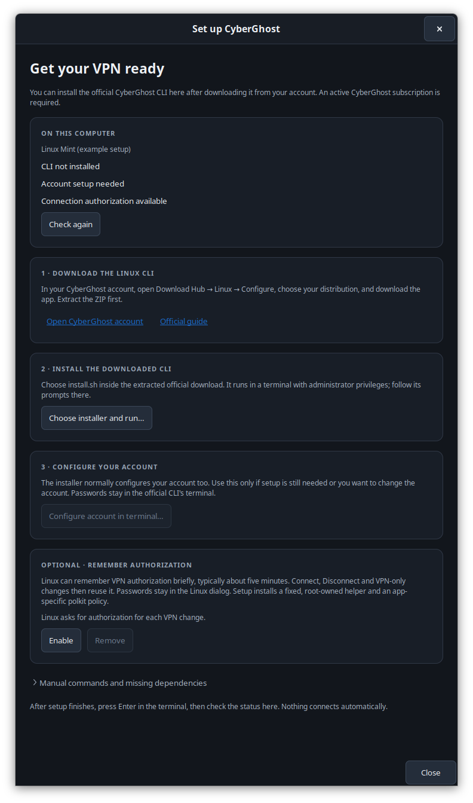
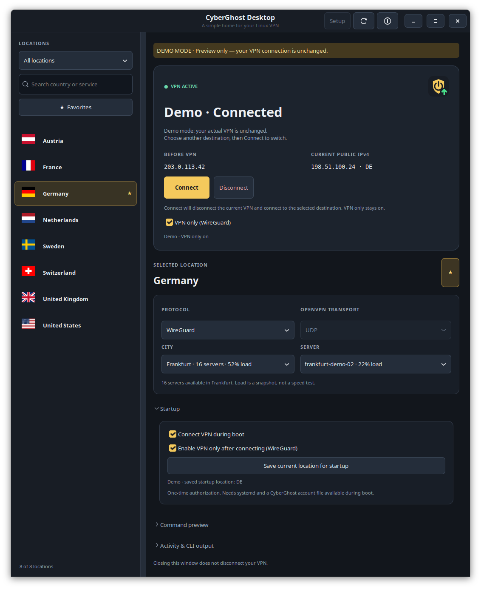

# CyberGhost-Linux-UI

A small native Linux desktop app for the CyberGhost VPN command line client.
Built with Python and GTK 3. This is an independent, unofficial project. CyberGhost is a trademark of its
owner; this project is not affiliated with CyberGhost.



## What it does

- Search live country lists, streaming services and P2P locations, with bundled country flags that work offline.
- Save favorite locations and remember your protocol and transport choices.
- Choose automatic city/server selection or an individual server with its reported load.
- Connect with WireGuard or OpenVPN; choose UDP or TCP for OpenVPN.
- Check connection status automatically and inspect the CLI's output.
- Compare the public IPv4 address from before connecting with the current VPN exit.
- Optionally block traffic outside CyberGhost with a WireGuard kill switch.
- Optionally connect a saved location during boot with one-time authorized setup,
  and open the desktop app when you sign in.
- Use the optional desktop tray to reopen the window or disconnect. The same app
  shield in the connection panel and tray shows a green arrow when connected, a
  red cross when disconnected, and an amber question mark while changing
  connections or when status is unknown.
- Preview the exact command or try the interface with `--demo`.
- Install and configure the official CLI through a guided Setup screen.

No connection starts on launch, location selection, preference restore or refresh.
If you enable **Connect VPN during boot**, a separate boot service connects to
the saved location after networking becomes available.
Connect and Disconnect use normal Linux polkit authorization dialogs. Setup can
also launch the official installer or account setup through `sudo` in a terminal.
The desktop app never asks for or stores your password.
The authorized CLI receives your Linux username so it can use your existing
CyberGhost configuration, instead of looking for a separate root account setup.

## Requirements

- Linux with Python 3.10+, GTK 3 and PyGObject.
- The official CyberGhost Linux CLI and an active subscription to use the VPN.
  The CLI can be installed afterward through **Setup**; it is not needed to open the UI.
- `pkexec` and a desktop polkit authentication agent for connection changes.
- `iproute2` (`ip`) for WireGuard status checks without administrator prompts.
- Optional `nftables` and `wireguard-tools` for the WireGuard kill switch.
- Optional systemd for connection during boot. The CLI and its account file must
  be available before desktop login.
- Bash, `sudo` and a terminal for guided CLI installation and account setup.
- Optional Ayatana/AppIndicator support for a tray icon.

On Ubuntu or Linux Mint, the UI packages are:

```sh
sudo apt install python3-gi python3-gi-cairo gir1.2-gtk-3.0 pkexec iproute2 bash sudo
# Optional tray support:
sudo apt install gir1.2-ayatanaappindicator3-0.1
# Optional kill switch:
sudo apt install nftables wireguard-tools
```

Install the desktop dependencies first. The **Setup** screen guides you through
CyberGhost's own CLI installer and account configuration afterward.

### Other distributions and shells

Setup detects `/etc/os-release` and the available package manager, then shows
appropriate dependency commands for Debian/Ubuntu/Mint, Fedora/RHEL derivatives,
Arch derivatives and openSUSE. It does not install system packages automatically.
You can inspect your environment without opening a window or changing the VPN:

```sh
sh ./run.sh --check
```

Common UI package commands (use a release with **Python 3.10+**):

```sh
# Fedora; RHEL-family package availability depends on the enabled repositories
sudo dnf install python3-gobject gtk3 polkit iproute bash sudo

# Arch / Manjaro
sudo pacman -S --needed python-gobject gtk3 polkit iproute2 bash sudo

# openSUSE: GTK bindings must match the system Python version
sudo zypper install python3-gobject python3-gobject-Gdk typelib-1_0-Gtk-3_0 polkit iproute2 bash sudo
```

These package conventions follow the [PyGObject installation guidance](https://pygobject.gnome.org/getting_started.html),
using GTK 3 for this app. Setup supports GNOME Terminal, Ptyxis, Konsole, Xfce
Terminal, xterm and Debian's terminal alternative. The launcher uses POSIX `sh`;
your login shell can be Bash, Zsh or Fish. Bash is detected separately for the
official CyberGhost installer, and no shell profile is edited.

Manual controls can be used without systemd; the boot-connection controls are
disabled when systemd is not running. Tray support additionally needs a desktop
with an AppIndicator host; use `--no-tray` otherwise. This is a normal desktop app,
not a Flatpak/Snap/container package. The launcher and privileged helpers expect
the conventional system Python at `/usr/bin/python3`.

UI dependency support does not imply that CyberGhost ships a working CLI for
every distribution. Its [current CLI FAQ](https://support.cyberghostvpn.com/hc/en-us/articles/360020835894-CyberGhost-VPN-CLI-App-Linux-FAQ)
lists Debian 12+, Ubuntu 22.04+, Fedora 34+, Alma and Rocky on 64-bit Linux.
Choose the download offered for your system in your CyberGhost account. Arch,
openSUSE and other systems require a separately working CLI; older RHEL-family
releases may also need a newer Python with matching GTK bindings.

Runtime checks have been performed on Linux Mint. Other distro paths are covered
by simulated detection tests and source review, not full VPN tests on those systems.

## Install from GitHub

Install the desktop requirements above, then clone this repository into a folder you want
to keep:

```sh
git clone https://github.com/r-vage/CyberGhost-Linux-UI.git
cd CyberGhost-Linux-UI
/usr/bin/python3 install.py
```

You can also use GitHub's **Code → Download ZIP**, extract the archive, open a
terminal in the extracted folder, and run `/usr/bin/python3 install.py`.
Executable permissions on the downloaded scripts are not required.

Run the installer as your normal user, without `sudo`. It adds **CyberGhost Desktop**
to your application menu and creates `~/.local/bin/cyberghost-desktop`. It installs
only the UI launchers and icon. Use **Setup** in the app to install the official
CyberGhost client if needed. No Python packages need to be installed with
`pip` for this checkout-based installation.

## First-run CLI setup

Setup opens automatically if the CLI, account configuration or authorization tool
is missing. You can also open **Setup** from the window header at any time.

1. Open your **CyberGhost account** from Setup. In **Download Hub → Linux → Configure**,
   choose your distribution and download the CLI. Extract the downloaded ZIP.
2. Click **Choose installer and run…**, select `install.sh` in that extracted folder,
   and follow the terminal prompts. The official installer handles its dependencies
   and account setup. The desktop window stays open while this runs.
3. If account configuration is still needed, use **Configure account in terminal…**.
   This runs `sudo cyberghostvpn --setup`.
4. Press Enter when the terminal finishes. Setup checks again automatically; the
   **Check again** button also detects installations completed outside the app.
   Close Setup, choose a location and connect.

The download comes from your CyberGhost account, as described in the
[official installation guide](https://support.cyberghostvpn.com/hc/en-us/articles/360020436274-Set-Up-CyberGhost-VPN-CLI-App-on-Linux).
This project does not bundle the proprietary CLI or handle CyberGhost login credentials.
Setup checks whether a configuration file exists; account access is verified by the
official CLI when connecting. Manual commands remain available in Setup if your
terminal is unsupported.



## Run

From this repository:

```sh
sh ./run.sh
```

The launcher uses `/usr/bin/python3` so that it can see the system GTK bindings,
even when pyenv or a machine-learning virtual environment is active.

Preview without changing your real VPN, or run without a tray icon:

```sh
sh ./run.sh --demo       # Sample data only; never invokes CyberGhost or polkit
sh ./run.sh --no-tray    # Closing the window exits the app
sh ./run.sh --setup      # Open guided CLI installation and account setup
sh ./run.sh --check      # Show distro, dependency and boot-service capabilities
```

## Update, move or uninstall

The launcher points to this checkout, so keep the folder in place. For a Git
checkout, update with `git pull`, then rerun `/usr/bin/python3 install.py`. For a
ZIP installation, replace the project files with the new release and rerun the
installer. Reopen the app to load updated code.
If boot connection is enabled, use **Startup → Save current location for startup**
after updating to refresh its protected helper copies as well.

After moving or copying the project, run `/usr/bin/python3 install.py` **from the
new folder**. It updates the existing launcher to that location; the old checkout
is no longer needed by the launcher.

To remove the UI launchers:

```sh
/usr/bin/python3 install.py --uninstall
```

This removes only this app's launchers and icon. It does not remove CyberGhost,
disconnect your VPN, disable an active kill switch, or delete preferences. Turn
**VPN only** off before removing the project if you want normal internet access
after disconnecting. You can then remove the project folder.
If **Connect VPN during boot** is enabled, disable it in the app first. The
uninstaller requires this so its authorized boot service is also removed.

## Using the app

Choose a location from the left, optionally choose a city and server, and click
**Connect**. Complete Linux's authorization dialog if prompted. The interface
then checks the CLI's status and, when needed, CyberGhost's WireGuard interface
and IPv4 routing. These status checks run without authorization prompts; a
successful connect command alone is not treated as proof that the VPN connected.

CyberGhost CLI 1.5.0 can report no connections for WireGuard when run without
administrator privileges. The desktop app checks the actual `cyberghost` interface
and its internet route to handle this. If status cannot be verified, it shows
**Status unavailable** and keeps Connect disabled until a disconnected state is
confirmed. Refresh checks again; Disconnect remains available for an existing tunnel.

Disconnect before connecting somewhere else. Streaming selections keep their
exact service name and let CyberGhost choose the matching server. City and server
loads are snapshots supplied by the CLI, not speed tests.

The locations panel keeps its width when the window is resized; the right side
uses the additional space. Drag the divider to choose a different sidebar width.

The top panel shows **Before VPN** and **Current public IPv4**. It checks Cloudflare
over HTTPS on connection-state changes and when you press Refresh. If the app opens
while already connected, the previous address stays unknown until an address has
been checked while disconnected. Addresses stay in memory and are not written to
preferences or Activity. The lookup ignores HTTP proxy settings so it reports this
computer's network exit. An unavailable lookup does not change the VPN status;
it is an IPv4 check, not a complete IPv6/DNS leak test.
CyberGhost currently supports IPv4 VPN traffic, according to its
[connection-leak guidance](https://support.cyberghostvpn.com/hc/en-us/articles/213353589-How-to-Avoid-Connection-Leaks).
The app's VPN-only firewall covers both IPv4 and IPv6 outside the tunnel.

Closing the window or quitting **leaves the VPN connection unchanged**. With tray
support, closing hides the window; choose **Quit** from the tray to exit. On
desktops without a tray host, use `--no-tray`. Boot connection is optional and off
by default. DNS and account configuration remain with the official CLI.

### Connect during boot

1. Choose the location, protocol and optional city/server you want at startup.
2. Expand **Startup** beneath the connection settings.
3. Optionally select **Enable VPN only after connecting (WireGuard)**.
4. Enable **Connect VPN during boot** and complete Linux's authorization dialog.

Setup saves this specific connection in a protected system profile and enables
a systemd service for the **next boot**. It does not reconnect the current session.
The service connects before desktop login, after the network becomes available.
The app opens separately when you sign into your desktop. Later boots do not need
another password prompt.

The location list waits while the boot connection is running. If DNS or the
network is still becoming available, the app retries loading locations for up to
three minutes instead of displaying a startup traceback. Connection status stays
visible; persistent failures still show an error and can be retried with **Refresh**.

Changing the main location controls does not change the saved boot connection.
Use **Save current location for startup** to apply a new location, protocol or
startup VPN-only choice. Updating or disabling the boot setup requires authorization
again. Disabling it removes the service, profile, helper copies and desktop startup
entry while leaving the current VPN and firewall state alone. One account can own
the boot connection on a computer.

The service preserves an existing VPN and does not reconnect continuously after
failures or after you manually disconnect. It waits up to three minutes for an
IPv4 route; the Startup section shows its last result. An encrypted or login-mounted
home directory can prevent access to CyberGhost's account file before login.
In that case, connect manually after signing in.

Early boot traffic may use the normal network until the VPN connects; startup
VPN-only protection is applied **after** the connection is verified. If the VPN
connects before the app opens, **Before VPN** stays unknown for that session.

The boot service runs root-owned copies of the startup helpers, not Python code
from a user-writable checkout. It uses the existing CyberGhost account and stores
no new passwords or credentials. Service details are also available through:

```sh
journalctl -u "cyberghost-desktop-startup-$(id -u).service" -b
```



### Server changes and authorization

While connected, choose another country, city, server or protocol. **Connect**
becomes available for the changed destination. Clicking it disconnects the current
VPN, verifies that it stopped, then establishes the selected connection in one
authorized action. Changing the selection alone does not disconnect anything.

To avoid repeated password dialogs, open **Setup → Optional · Remember
authorization → Enable**. This installs an app-specific polkit policy and a fixed,
root-owned helper. Linux can then retain authorization briefly—typically about
five minutes—for Connect, Disconnect and VPN-only controls. The timeout is managed
by polkit and may differ with system policy; this does not reuse or change sudo's
terminal cache. The app never stores your password.

After updating the project, Setup offers **Update** when the installed helper no
longer matches the app. Updating or removing it requires fresh authorization.
Use **Remove** in that section before deleting the project if you also want to
remove this optional system integration. Without it, the app continues to request
authorization for each change. No global password-free sudo/Python rule is added.

### Optional WireGuard kill switch

**VPN only (WireGuard)** is off by default. Connect with WireGuard, then enable it
in the top panel and authorize the firewall change. OpenVPN is not supported by
this option. Existing firewall rules remain in place.

While enabled, normal IPv4 and IPv6 traffic must leave through CyberGhost. Direct
internet and LAN traffic are blocked if the tunnel disappears, including existing
connections and forwarded traffic such as ordinary Docker bridge traffic. Local
loopback, WireGuard's encrypted transport and essential DHCP/IPv6 neighbor discovery
remain allowed. It does not control privileged applications or separate network
namespaces that manage their own network interfaces.

Protection **stays enabled after Disconnect or Quit**, until you turn it off or
reboot. The optional startup setting can enable it again after the next boot's
VPN connection. Leave it checked when changing servers: **Connect** establishes the
next WireGuard connection while keeping ordinary traffic blocked. Linux authorizes
the connection once; there is no separate protection toggle. A temporary exception
is restricted to CyberGhost's connection process and is removed after success or
failure. Protected reconnects require cgroup v2 and the `unshare`, `mount` and
`nsenter` tools from util-linux, plus configured uplink DNS servers. If setup fails,
protection stays enabled. Saved locations and previously loaded servers remain
available offline; use Automatic for a new choice, then Refresh after connecting.
It is not a boot-time firewall or an automatic reconnect feature.

A small authorized helper checks the actual firewall rules so status refreshes
do not need repeated password prompts. If it cannot verify the rules, the app
shows **unknown**, not protected. Turn the option off to recover, then connect
and enable it again. If the app is unavailable, this command removes only its table:

```sh
sudo nft delete table inet cyberghost_desktop
```

The firewall monitor exits when VPN only is disabled. No password or sudoers
exception is stored. A custom polkit policy is installed only if you separately
enable **Remember authorization** in Setup.

Keyboard shortcuts: **Ctrl+F** search, **F5** refresh, **Ctrl+Q** quit.

Preferences are stored separately at
`~/.config/cyberghost-desktop/preferences.json` (or beneath `$XDG_CONFIG_HOME`).
Only choices and favorites are saved. CLI output is kept in memory while the
window is open. Demo mode neither reads nor writes normal preferences.

## Development and checks

```sh
/usr/bin/python3 -m unittest discover -s tests -v
# Requires a graphical session, uses only an in-memory fake VPN:
/usr/bin/python3 tests/gui_smoke.py
/usr/bin/python3 tests/gui_setup.py
/usr/bin/python3 tests/gui_startup_wait.py
/usr/bin/python3 tests/gui_server_loading.py
# Kernel checks in disposable user/network namespaces; never the host firewall:
/usr/bin/python3 tests/firewall_namespace.py
```

The command adapter is independent of GTK and never uses a shell. Parser fixtures
match the installed CLI 1.5.0 output. Network failures and unknown status output
are shown explicitly. Catalog requests have timeouts and stale results are ignored.
Privileged commands stay asynchronous and are not killed midway through VPN changes.

See [implementation and validation notes](docs/implementation.md) for the tested
CLI commands and limits. A CyberGhost subscription and working official client
are still required; this app does not supply a VPN service.

Country flags are from [flag-icons](https://github.com/lipis/flag-icons) by
Panayiotis Lipiridis, used under the MIT license. The bundled flags include the
[upstream license](cyberghost_desktop/assets/flags/LICENSE) and
[source details](cyberghost_desktop/assets/flags/SOURCE.txt).
