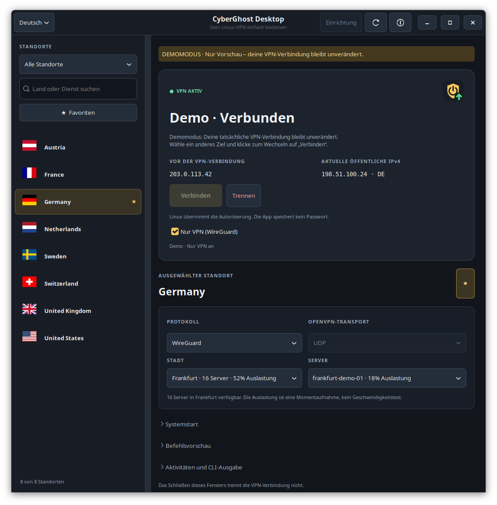
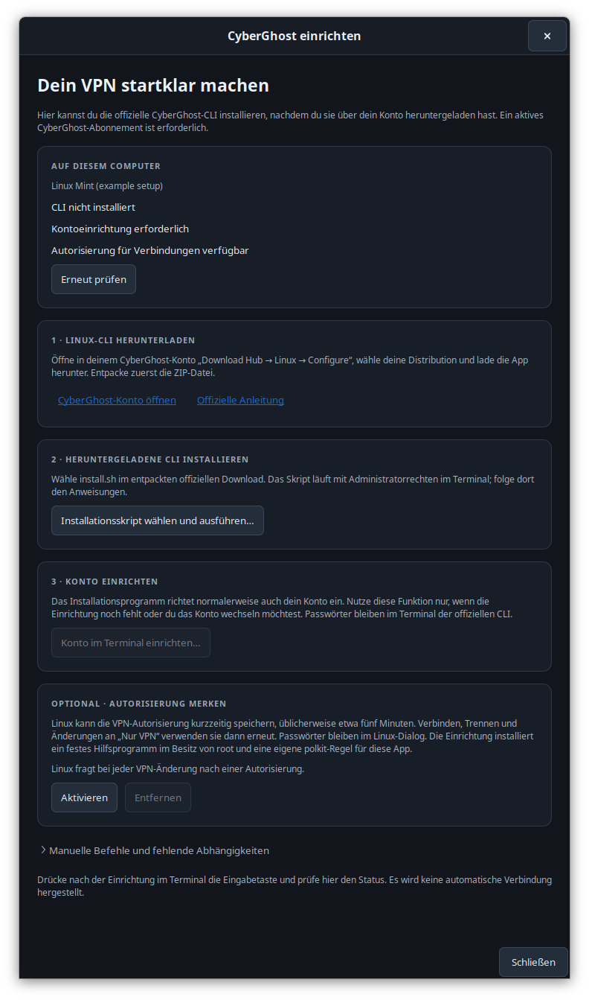
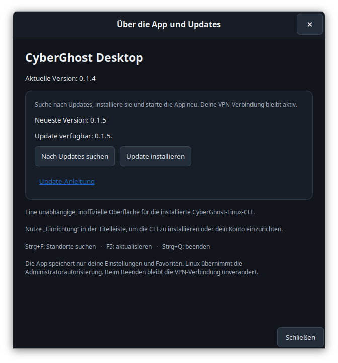
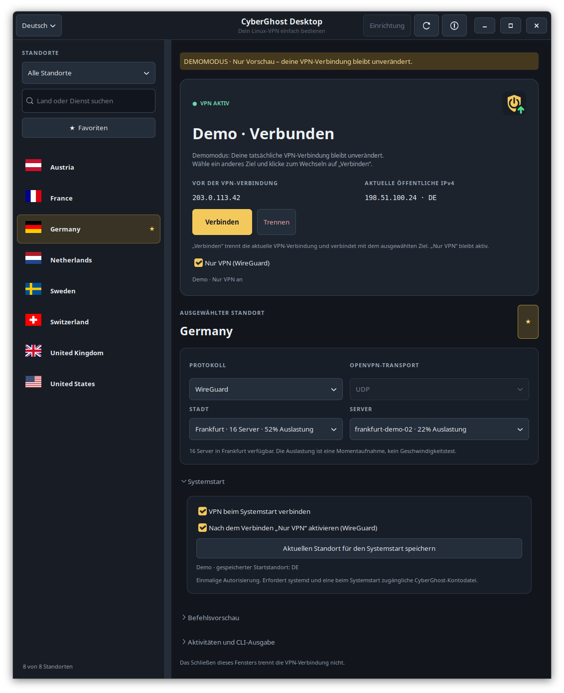

# CyberGhost-Linux-UI

**[English](README.md)** | **Deutsch** | **[简体中文](README_ZH.md)**

Eine kleine native Linux-Desktop-App für den CyberGhost-VPN-Kommandozeilenclient,
entwickelt mit Python und GTK 3. Dies ist ein unabhängiges, inoffizielles Projekt.
CyberGhost ist eine Marke ihres Inhabers; dieses Projekt steht in keiner
Verbindung mit CyberGhost.

Der **[visuelle Rundgang](docs/Visual_Tour.md)** zeigt Standorte,
Verbindungssteuerung, Systemstart und Einrichtung mit beschrifteten Screenshots
(auf Englisch). Die folgenden Aufnahmen zeigen die echte deutsche Oberfläche
mit Demodaten und verändern keine VPN-Verbindung.



## Funktionen

- Aktuelle Länderlisten, Streamingdienste und P2P-Standorte durchsuchen. Die mitgelieferten Länderflaggen funktionieren auch offline.
- Favoriten speichern und die Auswahl von Protokoll und Transport beibehalten.
- Stadt und Server automatisch wählen lassen oder einen bestimmten Server mit angezeigter Auslastung auswählen.
- Mit WireGuard oder OpenVPN verbinden; bei OpenVPN zwischen UDP und TCP wählen.
- Verbindungsstatus automatisch prüfen und die CLI-Ausgabe einsehen.
- Die öffentliche IPv4-Adresse vor der Verbindung mit dem aktuellen VPN-Ausgang vergleichen.
- Optional Verkehr außerhalb von CyberGhost mit einem WireGuard-Kill-Switch blockieren.
- Optional einen gespeicherten Standort beim Systemstart verbinden und die Desktop-App bei der Anmeldung öffnen.
- Über das optionale Taskleistensymbol das Fenster öffnen oder die Verbindung trennen. Ein grüner Pfeil bedeutet „verbunden“, ein rotes Kreuz „getrennt“ und ein gelbes Fragezeichen einen laufenden Verbindungswechsel oder unbekannten Status.
- Den genauen Befehl vorab ansehen oder die Oberfläche mit `--demo` ausprobieren.
- Die offizielle CLI über eine geführte Einrichtung installieren und konfigurieren.
- Die aktuelle App-Version anzeigen, nach Updates suchen, sie installieren und die App neu starten.
- Direkt zwischen 15 Oberflächensprachen wechseln. Weitere Sprachen lassen sich über bearbeitbare Übersetzungsdateien ergänzen.

Beim Öffnen der App, Auswählen eines Standorts, Wiederherstellen von Einstellungen
oder Aktualisieren wird keine Verbindung gestartet. Wenn du **VPN beim Systemstart
verbinden** aktivierst, verbindet ein separater Dienst mit dem gespeicherten
Standort, sobald das Netzwerk verfügbar ist.

**Verbinden** und **Trennen** verwenden die normalen polkit-Autorisierungsdialoge
von Linux. Die Einrichtung kann außerdem den offiziellen Installer oder die
Kontoeinrichtung über `sudo` in einem Terminal starten. Die Desktop-App fragt
niemals nach deinem Passwort und speichert es nicht. Die autorisierte CLI erhält
deinen Linux-Benutzernamen, damit sie deine vorhandene CyberGhost-Konfiguration nutzt.

## Voraussetzungen

- Linux mit Python 3.10 oder neuer, GTK 3 und PyGObject.
- Die offizielle CyberGhost-Linux-CLI und ein aktives Abonnement für die VPN-Nutzung. Die CLI kann später über **Einrichtung** installiert werden; zum Öffnen der Oberfläche ist sie nicht erforderlich.
- `pkexec` und ein polkit-Authentifizierungsagent der Desktopumgebung für Verbindungsänderungen.
- `iproute2` (`ip`) für WireGuard-Statusprüfungen ohne Administratorabfrage.
- Optional `nftables` und `wireguard-tools` für den WireGuard-Kill-Switch.
- Optional systemd für die Verbindung beim Systemstart. CLI und Kontodatei müssen vor der Desktop-Anmeldung verfügbar sein.
- Bash, `sudo` und ein Terminal für die geführte CLI-Installation und Kontoeinrichtung.
- Optional Ayatana/AppIndicator-Unterstützung für das Taskleistensymbol.

Unter Ubuntu oder Linux Mint:

```sh
sudo apt install python3-gi python3-gi-cairo gir1.2-gtk-3.0 pkexec iproute2 bash sudo
# Optionale Taskleistenunterstützung:
sudo apt install gir1.2-ayatanaappindicator3-0.1
# Optionaler Kill Switch:
sudo apt install nftables wireguard-tools
```

Installiere zuerst diese Desktop-Abhängigkeiten. Anschließend führt dich
**Einrichtung** durch den offiziellen CyberGhost-Installer und die Kontokonfiguration.

### Andere Distributionen und Shells

Die Einrichtung erkennt `/etc/os-release` und den verfügbaren Paketmanager. Sie
zeigt passende Befehle für Debian/Ubuntu/Mint, Fedora/RHEL-Derivate, Arch-Derivate
und openSUSE an, installiert Systempakete aber nicht automatisch. Prüfe deine
Umgebung ohne Fenster und ohne VPN-Änderungen mit:

```sh
sh ./run.sh --check
```

Gängige Paketbefehle für die Oberfläche; verwende eine Version mit **Python 3.10+**:

```sh
# Fedora; bei RHEL-Derivaten hängt die Verfügbarkeit von den aktivierten Repositories ab
sudo dnf install python3-gobject gtk3 polkit iproute bash sudo

# Arch / Manjaro
sudo pacman -S --needed python-gobject gtk3 polkit iproute2 bash sudo

# openSUSE: Die GTK-Anbindung muss zur System-Python-Version passen
sudo zypper install python3-gobject python3-gobject-Gdk typelib-1_0-Gtk-3_0 polkit iproute2 bash sudo
```

Die Paketangaben orientieren sich an der
[PyGObject-Installationsanleitung](https://pygobject.gnome.org/getting_started.html),
wobei diese App GTK 3 verwendet. Die Einrichtung unterstützt GNOME Terminal,
Ptyxis, Konsole, Xfce Terminal, xterm und Debians Terminalalternative. Der Starter
verwendet POSIX `sh`; deine Anmeldeshell kann Bash, Zsh oder Fish sein. Bash wird
für den offiziellen CyberGhost-Installer gesondert gesucht. Shell-Profile werden
nicht bearbeitet.

Die manuelle Steuerung funktioniert ohne systemd; die Startoptionen sind dann
deaktiviert. Das Taskleistensymbol benötigt eine Desktopumgebung mit
AppIndicator-Unterstützung. Verwende andernfalls `--no-tray`. Die App ist eine
normale Desktopanwendung, kein Flatpak-, Snap- oder Containerpaket. Starter und
privilegierte Hilfsprogramme erwarten System-Python unter `/usr/bin/python3`.

Unterstützte UI-Abhängigkeiten bedeuten nicht, dass CyberGhost für jede
Distribution eine funktionierende CLI anbietet. Die
[CLI-FAQ](https://support.cyberghostvpn.com/hc/en-us/articles/360020835894-CyberGhost-VPN-CLI-App-Linux-FAQ)
nennt Debian 12+, Ubuntu 22.04+, Fedora 34+, Alma und Rocky unter 64-Bit-Linux.
Wähle den Download für dein System im CyberGhost-Konto. Arch, openSUSE und andere
Systeme benötigen eine separat funktionierende CLI; ältere RHEL-Derivate können
außerdem ein neueres Python mit passenden GTK-Anbindungen benötigen.

Laufzeitprüfungen wurden unter Linux Mint durchgeführt. Andere Distributionen
wurden durch simulierte Erkennungstests und Quellcodeprüfung abgedeckt, nicht
durch vollständige VPN-Tests auf diesen Systemen.

## Von GitHub installieren

Installiere die genannten Desktop-Abhängigkeiten und klone das Repository in
einen Ordner, den du dauerhaft behalten möchtest:

```sh
git clone https://github.com/r-vage/CyberGhost-Linux-UI.git
cd CyberGhost-Linux-UI
/usr/bin/python3 install.py
```

Alternativ kannst du auf GitHub **Code → Download ZIP** verwenden, das Archiv
entpacken, dort ein Terminal öffnen und `/usr/bin/python3 install.py` ausführen.
Die heruntergeladenen Skripte müssen dafür nicht als ausführbar markiert sein.

Starte den Installer als normaler Benutzer, **ohne `sudo`**. Er legt
**CyberGhost Desktop** im Anwendungsmenü und `~/.local/bin/cyberghost-desktop` an.
Installiert werden nur die UI-Starter und das Symbol. Den offiziellen
CyberGhost-Client installierst du bei Bedarf über **Einrichtung**. Für diese
Installation aus dem Projektordner sind keine Python-Pakete über `pip` erforderlich.

## CLI beim ersten Start einrichten

Fehlen CLI, Kontokonfiguration oder Autorisierungswerkzeug, öffnet sich die
Einrichtung automatisch. Du kannst sie jederzeit über **Einrichtung** in der
Titelleiste aufrufen.

1. Öffne dein **CyberGhost-Konto** über die Einrichtung. Wähle unter **Download Hub → Linux → Configure** deine Distribution, lade die CLI herunter und entpacke die ZIP-Datei.
2. Klicke auf **Installationsskript wählen und ausführen…**, wähle `install.sh` aus dem entpackten Ordner und folge den Terminalanweisungen. Der offizielle Installer übernimmt seine Abhängigkeiten und die Kontoeinrichtung. Das Desktopfenster bleibt geöffnet.
3. Falls die Kontokonfiguration noch fehlt, nutze **Konto im Terminal einrichten…**. Dabei wird `sudo cyberghostvpn --setup` ausgeführt.
4. Drücke nach Abschluss im Terminal die Eingabetaste. Die Einrichtung prüft automatisch erneut. **Erneut prüfen** erkennt auch Installationen außerhalb der App. Schließe danach die Einrichtung, wähle einen Standort und verbinde dich.

Der Download stammt aus deinem CyberGhost-Konto, wie in der
[offiziellen Installationsanleitung](https://support.cyberghostvpn.com/hc/en-us/articles/360020436274-Set-Up-CyberGhost-VPN-CLI-App-on-Linux)
beschrieben. Dieses Projekt enthält weder die proprietäre CLI noch verarbeitet es
CyberGhost-Zugangsdaten. Die Einrichtung prüft das Vorhandensein einer
Konfigurationsdatei; den Kontozugriff prüft die offizielle CLI beim Verbinden.
Für nicht unterstützte Terminals stehen manuelle Befehle bereit.



## Starten

Aus dem Projektordner:

```sh
sh ./run.sh
```

Der Starter verwendet `/usr/bin/python3`, damit die GTK-Systemanbindungen auch
bei aktivem pyenv oder einer virtuellen Python-Umgebung verfügbar bleiben.

```sh
sh ./run.sh --demo       # Nur Beispieldaten; ruft weder CyberGhost noch polkit auf
sh ./run.sh --no-tray    # Schließen des Fensters beendet die App
sh ./run.sh --setup      # Geführte CLI-Installation und Kontoeinrichtung öffnen
sh ./run.sh --check      # Distribution, Abhängigkeiten und Startdienst-Funktionen anzeigen
```

## Sprache und Übersetzungen

Wähle oben links im Fenster eine Sprache. Verfügbar sind Arabisch, Deutsch,
Englisch, Französisch, Hebräisch, Italienisch, Japanisch, Koreanisch, Persisch,
Portugiesisch (Brasilien), Russisch, Spanisch, Türkisch sowie vereinfachtes und
traditionelles Chinesisch. Jede Sprache erscheint unter ihrem Eigennamen. Die
Oberfläche wechselt sofort und merkt sich deine Auswahl. Standort, Protokoll,
Server und VPN-Verbindung bleiben erhalten. Im Demomodus wird die Sprachauswahl
nur im Arbeitsspeicher gehalten.

Persönliche Übersetzungen liegen als bearbeitbare UTF-8-JSON-Dateien in
`~/.config/cyberghost-desktop/locales` beziehungsweise unter `$XDG_CONFIG_HOME`.
Die App erstellt diese Kopien beim Start. Updates ergänzen neue Nachrichten und
verbessern unveränderte Übersetzungen; deine Anpassungen bleiben erhalten. Ändern
beide Seiten dieselbe Nachricht, bleibt dein Text bestehen. Sicherungskopien und
die aktuelle Standardübersetzung werden zum Vergleichen aufbewahrt.

Neue Sprachdateien in diesem Ordner erscheinen nach einem Neustart im Auswahlmenü.
Für eine weitere Sprache kopierst du `en.json`, änderst Sprachcode und Eigenname
und übersetzt die Nachrichtenwerte. Für einen Pull Request legst du die Datei in
[`cyberghost_desktop/locales`](cyberghost_desktop/locales) ab und erzeugst das
Sprachmanifest neu. Reiche beide Dateien ein. Fehlende Übersetzungen erscheinen
auf Englisch. Die [Übersetzungsanleitung](docs/TRANSLATING.md) erklärt auf Englisch,
wie Anpassungen zusammengeführt, geprüft und in der Vorschau angezeigt werden.

Länder-, Städte-, Dienst- und Servernamen der CLI bleiben unverändert.
Unverarbeitete CLI- und Systemdiagnosen behalten ihre ursprüngliche Sprache.
Der offizielle Installer, Linux-Autorisierungsdialoge und eingebaute
GTK-Dateiauswahl-Steuerelemente verwenden ihre eigenen Spracheinstellungen.

## Aktualisieren, verschieben oder deinstallieren

Die aktuelle App-Version steht in der Fensterkopfzeile. Öffne **ⓘ → Über die App
und Updates** und wähle **Nach Updates suchen**, um sie mit der auf GitHub
veröffentlichten Version zu vergleichen. Ist ein Update verfügbar, wähle
**Update installieren** und anschließend **App neu starten**. Die Installation läuft
bei geöffneter App; VPN-Verbindung und Nur-VPN-Schutz bleiben aktiv. Die
VPN-Steuerung wartet auf den Neustart, der den neuen Code lädt. Prüfung und
Installation erfolgen nur auf Anfrage und sind im Demomodus deaktiviert.

Die Installation in der App benötigt Git und den Branch `main` des offiziellen
Repositorys. Sie führt ein Fast-Forward-Update aus, entsprechend `git pull --ff-only`.
Persönliche Übersetzungen bleiben außerhalb des Projektordners. Nicht zum Commit
vorgemerkte Änderungen an gültigen mitgelieferten Sprachdateien werden vor dem Update
gesichert und in die persönlichen Übersetzungen übernommen. Andere lokale Änderungen,
vorgemerkte Dateien oder eigene Commits erfordern ein manuelles Update.



Der Starter verweist auf den Projektordner. Behalte ihn daher an seinem Platz.
Manuell aktualisierst du ein Git-Checkout mit `git pull --ff-only` und führst anschließend
`/usr/bin/python3 install.py` erneut aus. Bei einer ZIP-Installation ersetzt du
die Projektdateien durch die neue Version und startest den Installer erneut.
Öffne die App neu, um den aktualisierten Code zu laden. **Update-Anleitung** öffnet
die englischen Hinweise zur Aktualisierung.

Bei aktivierter Startverbindung nutze nach einem Update **Systemstart → Aktuellen
Standort für den Systemstart speichern**, um auch die geschützten Kopien der
Hilfsprogramme zu aktualisieren.

Nach dem Verschieben oder Kopieren des Projekts führe `/usr/bin/python3 install.py`
**aus dem neuen Ordner** aus. Dadurch wird der vorhandene Starter angepasst;
der alte Ordner wird vom Starter nicht mehr benötigt.

So entfernst du die UI-Starter:

```sh
/usr/bin/python3 install.py --uninstall
```

Dies entfernt nur die Starter und das Symbol dieser App. CyberGhost,
VPN-Verbindung, ein aktiver Kill Switch und Einstellungen bleiben erhalten.
Deaktiviere **Nur VPN** vor dem Entfernen des Projekts, wenn nach dem Trennen
normaler Internetzugriff möglich sein soll. Danach kannst du den Projektordner
löschen. Ist **VPN beim Systemstart verbinden** aktiviert, deaktiviere es zuerst
in der App. Der Deinstaller verlangt dies, damit auch der autorisierte Startdienst
entfernt wird.

## Die App verwenden

Wähle links einen Standort, optional Stadt und Server, und klicke auf
**Verbinden**. Bestätige gegebenenfalls den Linux-Autorisierungsdialog.
Die App prüft anschließend den CLI-Status sowie bei Bedarf die WireGuard-Schnittstelle
von CyberGhost und das IPv4-Routing. Diese Statusprüfungen benötigen keine
Autorisierung. Ein erfolgreich beendeter Verbindungsbefehl allein gilt nicht als
Nachweis einer aktiven VPN-Verbindung.

CyberGhost CLI 1.5.0 kann ohne Administratorrechte fälschlich melden, dass keine
WireGuard-Verbindung besteht. Deshalb prüft die App die tatsächliche Schnittstelle
`cyberghost` und ihre Internetroute. Lässt sich der Status nicht bestätigen,
erscheint **Status nicht verfügbar**. Verbinden bleibt deaktiviert, bis eine
Trennung bestätigt ist. Aktualisieren prüft erneut; Trennen bleibt für einen
vorhandenen Tunnel verfügbar.

Beim Serverwechsel trennt die App zuerst die bisherige Verbindung; siehe unten.
Bei Streaming bleibt der genaue Dienstname erhalten, während CyberGhost den
passenden Server wählt. Auslastungsangaben für Städte und Server sind
Momentaufnahmen der CLI und keine Geschwindigkeitsmessungen.

Die Standortleiste behält beim Vergrößern des Fensters ihre Breite. Ziehe die
Trennlinie, um eine andere Breite einzustellen.

Die obere Karte zeigt **Vor der VPN-Verbindung** und **Aktuelle öffentliche IPv4**.
Die Prüfung erfolgt über Cloudflare per HTTPS bei Statusänderungen und beim
Aktualisieren. Öffnest du die App bei bereits verbundenem VPN, bleibt die frühere
Adresse unbekannt, bis im getrennten Zustand eine Adresse geprüft wurde.
Adressen bleiben im Arbeitsspeicher und werden weder in Einstellungen noch im
Aktivitätsprotokoll gespeichert. HTTP-Proxy-Einstellungen werden bei der Abfrage
ignoriert, damit sie den Netzwerkausgang dieses Computers zeigt.

Eine fehlgeschlagene Adressabfrage verändert den VPN-Status nicht. Es handelt sich
um eine IPv4-Prüfung, nicht um einen vollständigen IPv6-/DNS-Leak-Test. Laut
CyberGhosts [Hinweisen zu Verbindungslecks](https://support.cyberghostvpn.com/hc/en-us/articles/213353589-How-to-Avoid-Connection-Leaks)
unterstützt der VPN-Dienst IPv4-Verkehr. Die „Nur VPN“-Firewall dieser App erfasst
IPv4 und IPv6 außerhalb des Tunnels.

**Schließen oder Beenden lässt die VPN-Verbindung unverändert.** Mit
Taskleistenunterstützung wird das Fenster beim Schließen ausgeblendet; über
**Beenden (VPN-Verbindung beibehalten)** im Symbolmenü beendest du die App.
Ohne geeignete Taskleiste verwende `--no-tray`. Die Startverbindung ist optional
und standardmäßig aus. DNS- und Kontokonfiguration bleiben Aufgabe der offiziellen CLI.

### Beim Systemstart verbinden

1. Wähle Standort, Protokoll und gegebenenfalls Stadt und Server.
2. Klappe **Systemstart** unter den Verbindungseinstellungen auf.
3. Aktiviere optional **Nach dem Verbinden „Nur VPN“ aktivieren (WireGuard)**.
4. Aktiviere **VPN beim Systemstart verbinden** und bestätige die Linux-Autorisierung.

Die Einrichtung speichert diese Verbindung in einem geschützten Systemprofil und
aktiviert einen systemd-Dienst für den **nächsten Systemstart**. Die aktuelle
Sitzung wird nicht neu verbunden. Der Dienst verbindet vor der Desktop-Anmeldung,
sobald das Netzwerk verfügbar ist. Die App öffnet sich separat bei der Anmeldung.
Bei späteren Systemstarts ist keine erneute Passwortabfrage erforderlich.

Die Standortliste wartet auf die Startverbindung. Sind Netzwerk oder DNS noch
nicht bereit, versucht die App das Laden bis zu drei Minuten lang erneut.
Der Verbindungsstatus bleibt sichtbar. Dauerhafte Fehler werden angezeigt und
können mit Aktualisieren erneut geprüft werden.

Änderungen an der normalen Standortauswahl ändern die gespeicherte Startverbindung
nicht. Nutze **Aktuellen Standort für den Systemstart speichern**, um Standort,
Protokoll oder Startschutz zu übernehmen. Aktualisieren und Deaktivieren erfordern
erneute Autorisierung. Das Deaktivieren entfernt Dienst, Profil, Hilfsprogrammkopien
und Desktop-Autostarteintrag; die aktuelle VPN- und Firewall-Situation bleibt
unverändert. Pro Computer kann ein Konto die Startverbindung verwalten.

Der Dienst erhält eine vorhandene VPN-Verbindung und verbindet nach Fehlern oder
manuellem Trennen nicht ständig neu. Er wartet bis zu drei Minuten auf eine
IPv4-Route; sein letztes Ergebnis erscheint unter Systemstart. Ein verschlüsseltes
oder erst bei der Anmeldung eingehängtes Home-Verzeichnis kann den Zugriff auf die
Kontodatei vor der Anmeldung verhindern. Verbinde in diesem Fall nach der Anmeldung
manuell.

Früher Datenverkehr beim Systemstart kann das normale Netzwerk nutzen, bis das VPN
verbunden ist. Der Startschutz wird **erst nach bestätigter Verbindung** aktiviert.
Verbindet sich das VPN vor dem App-Start, bleibt die vorherige IP-Adresse unbekannt.
Der Dienst verwendet Hilfsprogrammkopien im Besitz von root, das bestehende
CyberGhost-Konto und keine neu gespeicherten Passwörter. Weitere Details zeigt:

```sh
journalctl -u "cyberghost-desktop-startup-$(id -u).service" -b
```



### Serverwechsel und Autorisierung

Wähle während einer Verbindung ein anderes Land, eine andere Stadt, einen Server
oder ein Protokoll. **Verbinden** wird für das geänderte Ziel verfügbar. Ein Klick
trennt die aktuelle Verbindung, bestätigt die Trennung und verbindet dann mit
dem neuen Ziel – mit einer Autorisierung. Das Ändern der Auswahl allein trennt nichts.

Unter **Einrichtung → Optional · Autorisierung merken → Aktivieren** kannst du
wiederholte Passwortabfragen verringern. Diese Option installiert eine eigene
polkit-Regel und ein festes Hilfsprogramm im Besitz von root. Linux kann die
Autorisierung dann kurzzeitig, üblicherweise etwa fünf Minuten, für Verbinden,
Trennen und „Nur VPN“ behalten. Die Dauer wird von polkit und der Systemrichtlinie
bestimmt. Der `sudo`-Cache im Terminal wird nicht verwendet oder geändert, und
die App speichert kein Passwort.

Nach Projektupdates erscheint **Aktualisieren**, wenn die installierte
Hilfsprogrammkopie nicht mehr passt. Aktualisieren und Entfernen verlangen eine
frische Autorisierung. Nutze dort **Entfernen**, bevor du das Projekt löschst,
wenn du auch diese optionale Systemintegration entfernen möchtest. Ohne sie fragt
die App weiterhin bei jeder Änderung nach Autorisierung. Es wird keine globale
passwortfreie sudo- oder Python-Regel hinzugefügt.

### Optionaler WireGuard-Kill-Switch

**Nur VPN (WireGuard)** ist standardmäßig aus. Verbinde mit WireGuard, aktiviere
dann die Option in der oberen Karte und autorisiere die Firewall-Änderung.
OpenVPN wird von dieser Option nicht unterstützt. Vorhandene Firewall-Regeln
bleiben bestehen.

Bei aktivem Schutz muss normaler IPv4- und IPv6-Verkehr durch CyberGhost fließen.
Fällt der Tunnel aus, werden direkter Internet- und LAN-Verkehr blockiert, auch
bestehende Verbindungen und weitergeleiteter Verkehr wie üblicher Docker-Bridge-Verkehr.
Loopback, der verschlüsselte WireGuard-Transport und notwendige DHCP-/IPv6-
Nachbarschaftserkennung bleiben erlaubt. Privilegierte Anwendungen und separate
Netzwerk-Namespaces mit eigenen Schnittstellen werden damit nicht kontrolliert.

Der Schutz **bleibt nach Trennen oder Beenden aktiv**, bis du ihn ausschaltest
oder neu startest. Die optionale Starteinstellung kann ihn nach der nächsten
Startverbindung erneut aktivieren. Lasse ihn beim Serverwechsel eingeschaltet:
**Verbinden** stellt die nächste WireGuard-Verbindung her, während normaler
Verkehr blockiert bleibt. Es genügt eine Autorisierung. Eine vorübergehende
Ausnahme gilt ausschließlich für den CyberGhost-Verbindungsprozess und wird bei
Erfolg oder Fehler entfernt.

Geschütztes erneutes Verbinden erfordert cgroup v2, `unshare`, `mount` und `nsenter`
aus util-linux sowie konfigurierte DNS-Server der zugrunde liegenden
Netzwerkverbindung. Schlägt die Einrichtung fehl, bleibt der Schutz aktiv.
Gespeicherte Standorte und bereits geladene Server sind offline verfügbar.
Für neue Ziele kannst du die automatische Auswahl nutzen und nach dem Verbinden
aktualisieren. Diese Funktion ist keine Firewall für die frühe Startphase und
keine automatische Wiederverbindung.

Ein autorisierter Helfer prüft die tatsächlichen Firewall-Regeln, damit
Statusaktualisierungen keine wiederholten Passwortabfragen benötigen. Kann die
App die Regeln nicht bestätigen, zeigt sie einen unbekannten Status statt Schutz
zu behaupten. Schalte die Option aus, verbinde erneut und aktiviere sie wieder.
Ist die App nicht verfügbar, entfernt dieser Befehl ausschließlich ihre Tabelle:

```sh
sudo nft delete table inet cyberghost_desktop
```

Die Firewall-Überwachung endet beim Deaktivieren. Es wird weder ein Passwort noch
eine sudoers-Ausnahme gespeichert. Eine eigene polkit-Regel wird nur installiert,
wenn du **Autorisierung merken** gesondert aktivierst.

Tastenkürzel: **Strg+F** suchen, **F5** aktualisieren, **Strg+Q** beenden.
Einstellungen, Sprache, Favoriten und zwischengespeicherte Standortlisten liegen
unter `~/.config/cyberghost-desktop/preferences.json` beziehungsweise unter
`$XDG_CONFIG_HOME`. Die CLI-Ausgabe bleibt während der Fensterlaufzeit im
Arbeitsspeicher. Der Demomodus liest und schreibt keine normalen Einstellungen.

## Entwicklung und Prüfungen

Die Screenshots stammen aus der echten GTK-Oberfläche mit Demodaten. Die
[Aufnahmeanleitung](docs/implementation.md#documentation-captures) und die
[Übersetzungsanleitung](docs/TRANSLATING.md) beschreiben die erneute Erstellung.

```sh
/usr/bin/python3 -m unittest discover -s tests -v
/usr/bin/python3 tools/check_translations.py --complete
# Grafische Sitzung erforderlich; ausschließlich simuliertes VPN:
/usr/bin/python3 tests/gui_smoke.py
/usr/bin/python3 tests/gui_setup.py
/usr/bin/python3 tests/gui_startup_wait.py
/usr/bin/python3 tests/gui_server_loading.py
/usr/bin/python3 tests/gui_i18n.py
/usr/bin/python3 tests/gui_locale_store.py
/usr/bin/python3 tests/gui_updates.py
# Kernel-Prüfungen in temporären Benutzer-/Netzwerk-Namespaces:
/usr/bin/python3 tests/firewall_namespace.py
```

Der Befehlsadapter ist unabhängig von GTK und verwendet keine Shell. Die
Parser-Testdaten entsprechen der Ausgabe der CLI 1.5.0. Netzwerkfehler und
unbekannte Statusausgaben werden ausdrücklich angezeigt. Listenabfragen haben
Zeitlimits; veraltete Ergebnisse werden ignoriert. Privilegierte Befehle laufen
asynchron und werden nicht mitten in einer VPN-Änderung beendet.

Die [Implementierungs- und Prüfnotizen](docs/implementation.md) dokumentieren
getestete Befehle und Grenzen auf Englisch. Ein CyberGhost-Abonnement und ein
funktionierender offizieller Client bleiben erforderlich; diese App stellt
keinen eigenen VPN-Dienst bereit.

Die Länderflaggen stammen aus [flag-icons](https://github.com/lipis/flag-icons)
von Panayiotis Lipiridis und werden unter der MIT-Lizenz verwendet. Enthalten sind
die [Originallizenz](cyberghost_desktop/assets/flags/LICENSE) und
[Quellenangaben](cyberghost_desktop/assets/flags/SOURCE.txt).
