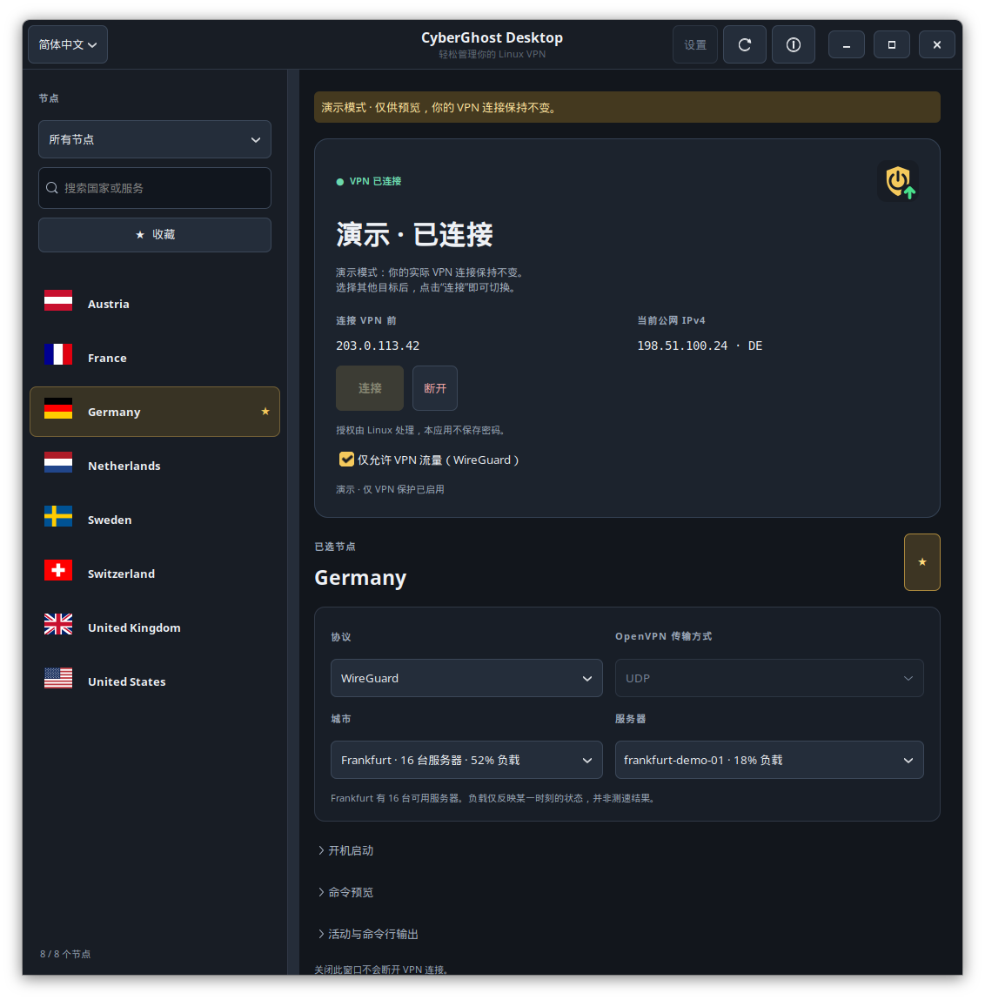
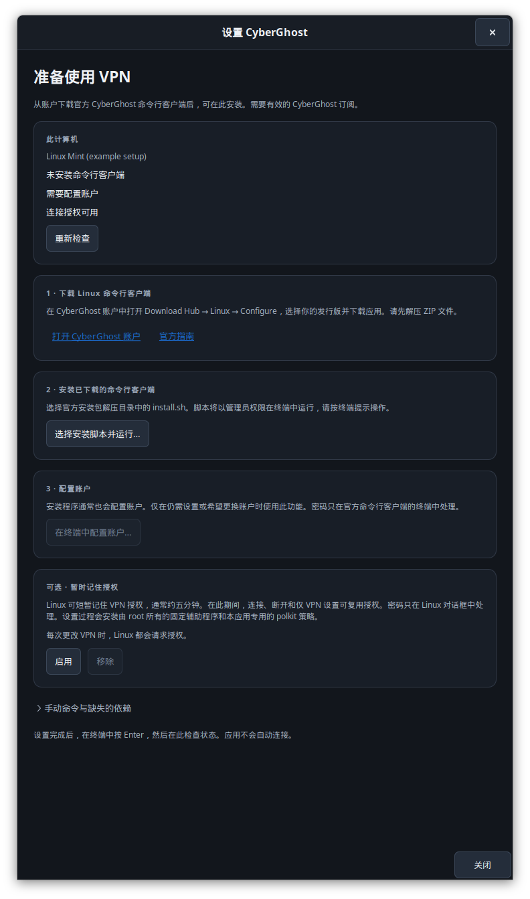
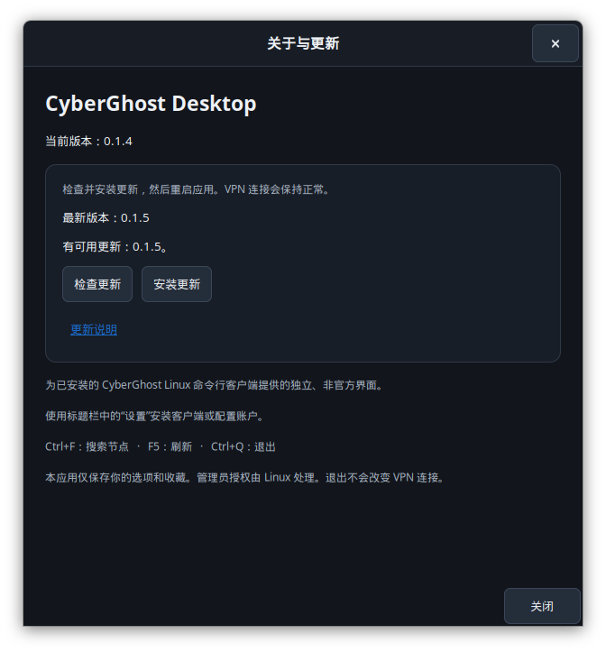
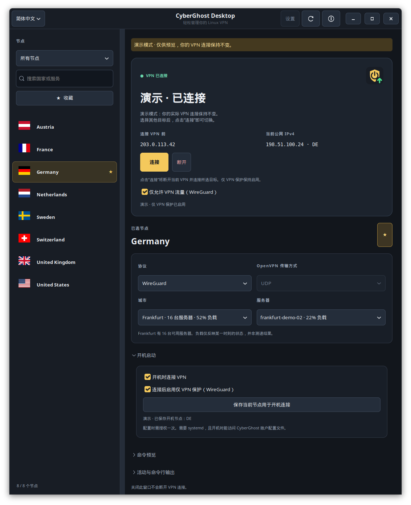

# CyberGhost-Linux-UI

**[English](README.md)** | **[Deutsch](README_DE.md)** | **简体中文**

为 CyberGhost VPN 命令行客户端提供的小型 Linux 原生桌面应用，使用 Python 和 GTK 3 开发。
这是一个独立的非官方项目，与 CyberGhost 无隶属关系。CyberGhost 商标归其所有者所有。

**[图解教程](docs/Visual_Tour.md)** 提供节点选择、连接控制、开机启动和设置的标注截图（英文）。
下方截图来自真实的中文 GTK 界面，使用演示数据，拍摄过程不会改变 VPN 连接。



## 功能

- 搜索实时国家列表、流媒体服务和 P2P 节点；内置国家旗帜，离线也可显示。
- 收藏常用节点，并记住协议和传输方式。
- 自动选择城市和服务器，或按显示的负载手动选择服务器。
- 支持 WireGuard 和 OpenVPN；OpenVPN 可选择 UDP 或 TCP。
- 自动检查连接状态，并查看命令行客户端输出。
- 对比连接前的公网 IPv4 地址与当前 VPN 出口地址。
- 可选 WireGuard 断网保护，阻止 CyberGhost 隧道以外的流量。
- 可选开机自动连接已保存的节点，并在登录桌面时打开应用。
- 通过可选的托盘图标重新打开窗口或断开连接。绿色箭头表示已连接，红色叉号表示已断开，黄色问号表示正在切换连接或状态未知。
- 预览实际执行的命令，或通过 `--demo` 体验界面。
- 通过引导式设置安装和配置官方命令行客户端。
- 查看当前应用版本、检查并安装更新，然后重启应用。
- 在 15 种界面语言之间即时切换，也可通过可编辑的翻译文件添加其他语言。

启动应用、选择节点、恢复偏好设置或刷新都不会发起连接。
启用**开机时连接 VPN**后，独立的开机服务会在网络就绪后连接已保存的节点。

**连接**和**断开**使用 Linux 标准的 polkit 授权对话框。
设置界面也可以在终端中通过 `sudo` 启动官方安装程序或账户配置。
桌面应用不会索取或保存你的密码。获得授权的命令行客户端会收到你的 Linux 用户名，
以使用现有的 CyberGhost 配置，而不是查找另一套 root 账户配置。

## 系统要求

- Linux、Python 3.10 或更新版本、GTK 3 和 PyGObject。
- 使用 VPN 需要官方 CyberGhost Linux 命令行客户端和有效订阅。客户端可稍后通过**设置**安装；打开界面本身不需要它。
- 更改连接需要 `pkexec` 和桌面环境的 polkit 认证代理。
- `iproute2`（`ip`），用于无需管理员授权的 WireGuard 状态检查。
- 可选 `nftables` 和 `wireguard-tools`，用于 WireGuard 断网保护。
- 可选 systemd，用于开机连接。命令行客户端及其账户配置文件必须在登录桌面前可用。
- Bash、`sudo` 和终端，用于引导式安装及账户设置。
- 可选 Ayatana/AppIndicator 支持，用于托盘图标。

Ubuntu 或 Linux Mint 所需的界面组件：

```sh
sudo apt install python3-gi python3-gi-cairo gir1.2-gtk-3.0 pkexec iproute2 bash sudo
# 可选托盘支持：
sudo apt install gir1.2-ayatanaappindicator3-0.1
# 可选断网保护：
sudo apt install nftables wireguard-tools
```

请先安装桌面依赖，再通过应用中的**设置**运行 CyberGhost 官方安装程序并配置账户。

### 其他发行版和 Shell

设置界面会检测 `/etc/os-release` 和可用的包管理器，显示适用于 Debian/Ubuntu/Mint、
Fedora/RHEL 衍生版、Arch 衍生版及 openSUSE 的依赖安装命令，但不会自动安装系统软件包。
可使用以下命令检查环境，无需打开窗口，也不会更改 VPN：

```sh
sh ./run.sh --check
```

常见发行版的界面依赖命令如下。请使用提供 **Python 3.10+** 的系统版本：

```sh
# Fedora；RHEL 系发行版的软件包可用性取决于启用的软件源
sudo dnf install python3-gobject gtk3 polkit iproute bash sudo

# Arch / Manjaro
sudo pacman -S --needed python-gobject gtk3 polkit iproute2 bash sudo

# openSUSE：GTK 绑定必须与系统 Python 版本匹配
sudo zypper install python3-gobject python3-gobject-Gdk typelib-1_0-Gtk-3_0 polkit iproute2 bash sudo
```

软件包名称参考 [PyGObject 安装指南](https://pygobject.gnome.org/getting_started.html)，本应用使用 GTK 3。
设置支持 GNOME Terminal、Ptyxis、Konsole、Xfce Terminal、xterm 和 Debian 的终端替代项。
启动脚本使用 POSIX `sh`；登录 Shell 可以是 Bash、Zsh 或 Fish。
官方 CyberGhost 安装程序所需的 Bash 会单独检测，应用不会修改 Shell 配置文件。

没有 systemd 时仍可手动控制 VPN，开机连接控件则会禁用。
托盘功能还需要桌面环境提供 AppIndicator 宿主，否则请使用 `--no-tray`。
这是普通桌面应用，并非 Flatpak、Snap 或容器包。启动脚本和特权辅助程序使用
`/usr/bin/python3` 处的系统 Python。

支持界面依赖并不意味着 CyberGhost 为每个发行版都提供可用的命令行客户端。
其 [CLI 常见问题](https://support.cyberghostvpn.com/hc/en-us/articles/360020835894-CyberGhost-VPN-CLI-App-Linux-FAQ)
列出了 64 位 Linux 上的 Debian 12+、Ubuntu 22.04+、Fedora 34+、Alma 和 Rocky。
请在 CyberGhost 账户中选择适用于自己系统的下载。Arch、openSUSE 等系统需要另外确保
官方客户端能正常运行；较旧的 RHEL 系版本可能还需要更新 Python 和匹配的 GTK 绑定。

运行验证在 Linux Mint 上完成。其他发行版通过模拟检测测试和源码审查覆盖，
未在这些系统上完成完整的 VPN 实测。

## 从 GitHub 安装

安装上述桌面依赖后，将仓库克隆到准备长期保留的目录：

```sh
git clone https://github.com/r-vage/CyberGhost-Linux-UI.git
cd CyberGhost-Linux-UI
/usr/bin/python3 install.py
```

也可在 GitHub 选择 **Code → Download ZIP**，解压后在该目录打开终端，
运行 `/usr/bin/python3 install.py`。下载的脚本不需要具备可执行权限。

请以普通用户运行安装程序，**不要使用 `sudo`**。
它会在应用菜单中添加 **CyberGhost Desktop**，并创建 `~/.local/bin/cyberghost-desktop`。
安装内容仅包括界面启动项和图标。如需官方 CyberGhost 客户端，请通过应用中的**设置**安装。
从项目目录运行的这种安装方式不需要使用 `pip` 安装 Python 软件包。

## 首次配置命令行客户端

缺少客户端、账户配置或授权工具时，设置界面会自动打开。
也可以随时点击标题栏中的**设置**。

1. 从设置界面打开 **CyberGhost 账户**。在 **Download Hub → Linux → Configure** 中选择发行版，下载客户端并解压 ZIP 文件。
2. 点击**选择安装脚本并运行…**，选择解压目录中的 `install.sh`，然后按终端提示操作。官方安装程序会处理所需依赖和账户设置，桌面窗口会保持打开。
3. 如果仍需配置账户，点击**在终端中配置账户…**，这会运行 `sudo cyberghostvpn --setup`。
4. 终端操作完成后按 Enter，设置界面会自动重新检查。**重新检查**也能检测在应用之外完成的安装。随后关闭设置，选择节点并连接。

下载来自你的 CyberGhost 账户，步骤见
[官方安装指南](https://support.cyberghostvpn.com/hc/en-us/articles/360020436274-Set-Up-CyberGhost-VPN-CLI-App-on-Linux)。
本项目不附带专有客户端，也不处理 CyberGhost 登录凭据。
设置界面检查配置文件是否存在，账户访问权限由官方客户端在连接时验证。
如果终端不受支持，仍可查看并执行设置界面中的手动命令。



## 运行

在仓库目录中运行：

```sh
sh ./run.sh
```

启动脚本使用 `/usr/bin/python3`，即使启用了 pyenv 或其他 Python 虚拟环境，
也能访问系统 GTK 绑定。

```sh
sh ./run.sh --demo       # 仅使用示例数据，不调用 CyberGhost 或 polkit
sh ./run.sh --no-tray    # 关闭窗口时退出应用
sh ./run.sh --setup      # 打开客户端安装和账户设置向导
sh ./run.sh --check      # 显示发行版、依赖和开机服务支持情况
```

## 语言与翻译

在窗口左上角选择语言。支持英语、德语、简体中文、繁体中文、日语、韩语、法语、
西班牙语、意大利语、巴西葡萄牙语、俄语、土耳其语、阿拉伯语、波斯语和希伯来语，
共 15 种语言，每种语言均以其本地名称显示。
界面会立即切换，并记住你的选择。切换语言会保留所选节点、协议、服务器和 VPN 连接。
演示模式下，语言选择仅保存在内存中。

个人翻译是可直接编辑的 UTF-8 JSON 文件，保存在
`~/.config/cyberghost-desktop/locales`（或 `$XDG_CONFIG_HOME` 下）。
应用会在启动时创建这些副本。更新会添加新消息、改进未修改的翻译，并保留你的自定义内容。
如果你和新版本都修改了同一条消息，会优先保留你的文本，同时保存备份和最新默认翻译以便比较。

在该目录添加新的语言文件后，重启应用即可在下拉菜单中选择它。
添加语言时，复制 `en.json`，修改语言代码和本地名称，再翻译消息的值。
如需贡献翻译，请将文件放入 [`cyberghost_desktop/locales`](cyberghost_desktop/locales)，
重新生成语言清单，并通过 Pull Request 提交这两个文件。缺少的翻译回退为英语。
[翻译贡献指南](docs/TRANSLATING.md)介绍了合并规则、检查和预览步骤（英文）。

命令行客户端提供的国家、城市、服务和服务器名称保持原样。
原始命令行输出和系统诊断保留其原有语言。官方安装程序、Linux 授权对话框和
GTK 内置文件选择器控件使用各自的语言设置。

## 更新、移动或卸载

窗口标题栏显示当前应用版本。打开 **ⓘ → 关于与更新**，点击**检查更新**，
即可与 GitHub 上发布的版本比较。有可用更新时，点击**安装更新**，完成后点击**重启应用**。
安装期间应用保持运行，VPN 连接和仅允许 VPN 流量的保护继续生效。
VPN 控件会暂停使用，直到重启加载新代码。检查和安装均需手动触发，演示模式下禁用这些操作。

应用内安装需要 Git，并且项目必须位于官方仓库的 `main` 分支。
更新仅使用快进合并，相当于 `git pull --ff-only`。个人翻译保存在项目目录之外。
对于随应用提供的有效语言文件，尚未暂存的本地修改会先备份并合入个人翻译，再安装更新。
其他本地修改、已暂存文件或本地提交需要手动处理更新。



启动项指向当前项目目录，因此请保留该目录。
Git 安装也可手动运行 `git pull --ff-only`，再运行 `/usr/bin/python3 install.py`。
ZIP 安装则用新版本替换项目文件，再运行安装程序。重新打开应用后会加载更新后的代码。
**更新说明**可打开英文更新指南。

如果启用了开机连接，更新后请使用**开机启动 → 保存当前节点用于开机连接**，
同时刷新受保护的辅助程序副本。

移动或复制项目后，请**在新目录中**运行 `/usr/bin/python3 install.py`。
现有启动项会更新为新位置，此后启动项不再需要旧目录。

移除界面启动项：

```sh
/usr/bin/python3 install.py --uninstall
```

这只会移除本应用的启动项和图标，不会卸载 CyberGhost、断开 VPN、关闭已启用的断网保护，
也不会删除偏好设置。如果希望断开 VPN 后恢复普通网络访问，请在删除项目之前关闭
**仅允许 VPN 流量**。之后可删除项目目录。
如果已启用**开机时连接 VPN**，必须先在应用中禁用它；卸载程序会要求先完成这一步，
以确保对应的授权开机服务也被移除。

## 使用应用

从左侧选择节点，可选指定城市和服务器，然后点击**连接**。
如有提示，请完成 Linux 授权对话框。界面随后检查客户端状态，并在需要时检查
CyberGhost 的 WireGuard 接口和 IPv4 路由。这些状态检查不需要授权提示；
连接命令成功返回并不单独作为 VPN 已连接的证明。

CyberGhost CLI 1.5.0 在没有管理员权限时可能错误地报告没有 WireGuard 连接。
本应用会检查实际的 `cyberghost` 接口及其互联网路由来处理这种情况。
若无法验证状态，会显示**无法获取状态**，并禁用连接按钮，直到确认已断开。
刷新可重新检查；存在隧道时，仍可使用断开按钮。

切换服务器时，应用会先断开原有连接，详见下文。
流媒体选择会保留准确的服务名称，由 CyberGhost 选择匹配服务器。
城市和服务器负载是客户端提供的瞬时数据，并非速度测试。

调整窗口大小时，左侧节点面板保持原有宽度，右侧使用新增空间。
拖动分隔线即可调整侧栏宽度。

顶部显示**连接 VPN 前**和**当前公网 IPv4**。
应用在连接状态变化或刷新时通过 HTTPS 向 Cloudflare 查询。
如果打开应用时已经连接 VPN，之前的地址会保持未知，直到在断开状态下完成一次查询。
地址只保存在内存中，不会写入偏好设置或活动记录。
查询会忽略 HTTP 代理设置，以显示本机实际的网络出口。

查询失败不会改变 VPN 状态。这只是 IPv4 检查，不是完整的 IPv6 或 DNS 泄漏测试。
根据 CyberGhost 的[连接泄漏说明](https://support.cyberghostvpn.com/hc/en-us/articles/213353589-How-to-Avoid-Connection-Leaks)，
其 VPN 支持 IPv4 流量。本应用的仅 VPN 防火墙同时覆盖隧道外的 IPv4 和 IPv6 流量。

**关闭窗口或退出应用不会改变 VPN 连接。**
启用托盘支持时，关闭窗口会将其隐藏；可在托盘菜单中选择**退出（保持 VPN 连接）**结束应用。
没有托盘宿主的桌面环境请使用 `--no-tray`。
开机连接为可选功能，默认关闭。DNS 和账户配置仍由官方客户端处理。

### 开机时连接

1. 选择开机时使用的节点、协议，以及可选的城市和服务器。
2. 展开连接设置下方的**开机启动**。
3. 可选勾选**连接后启用仅 VPN 保护（WireGuard）**。
4. 启用**开机时连接 VPN**，并完成 Linux 授权。

设置会将这条连接保存到受保护的系统配置中，并为**下次开机**启用 systemd 服务，
不会重新连接当前会话。该服务在网络就绪后、登录桌面前连接 VPN。
桌面应用则在你登录时单独打开。后续开机不需要再次输入密码。

开机连接运行期间，节点列表会等待。如果网络或 DNS 尚未就绪，应用会在三分钟内重试加载。
连接状态始终可见；持续失败会显示错误，也可通过刷新重试。

修改主界面的节点选项不会改变已保存的开机连接。
请使用**保存当前节点用于开机连接**应用新的节点、协议或开机保护选项。
更新或禁用开机设置需要再次授权。禁用会移除服务、配置、辅助程序副本和桌面自启动项，
但保留当前 VPN 与防火墙状态。一台计算机上只能由一个账户管理开机连接。

如果已有 VPN，开机服务会保留该连接。连接失败或手动断开后，它不会持续自动重连。
服务最多等待三分钟以获得 IPv4 路由；开机启动区域会显示最近结果。
如果用户主目录被加密或只在登录时挂载，服务可能无法在登录前访问账户配置文件。
这种情况下，请在登录后手动连接。

在 VPN 连接成功前，开机早期流量可能通过普通网络传输。
开机仅 VPN 保护会在**确认连接成功后**启用。
如果 VPN 在应用打开前已连接，本次会话的“连接 VPN 前”地址会保持未知。
开机服务运行由 root 所有的辅助程序副本，使用现有 CyberGhost 账户，不保存新的密码或凭据。
可通过以下命令查看服务详情：

```sh
journalctl -u "cyberghost-desktop-startup-$(id -u).service" -b
```



### 切换服务器与授权

保持连接时，也可以选择其他国家、城市、服务器或协议。
选择不同目标后，**连接**按钮会变为可用。点击后，应用先断开当前 VPN 并验证已停止，
再连接所选目标，整个操作只需一次授权。仅更改选项不会断开连接。

如需减少重复密码提示，打开**设置 → 可选 · 暂时记住授权 → 启用**。
这会安装应用专用的 polkit 策略和由 root 所有的固定辅助程序。
Linux 随后可短暂保留授权，通常约五分钟，用于连接、断开和仅 VPN 设置。
实际时限由 polkit 和系统策略决定，不会复用或更改终端中的 `sudo` 缓存。
本应用不会保存密码。

更新项目后，如果已安装的辅助程序与当前应用不匹配，设置界面会提供**更新**。
更新或移除都需要重新授权。如果希望删除项目时同时移除这项可选系统集成，
请先在该区域点击**移除**。未启用此功能时，每次更改仍会请求授权。
应用不会添加全局免密码 sudo 或 Python 规则。

### 可选 WireGuard 断网保护

**仅允许 VPN 流量（WireGuard）**默认关闭。
先使用 WireGuard 连接，再在顶部面板启用该选项，并授权防火墙更改。
该功能不支持 OpenVPN，也不会替换已有的其他防火墙规则。

启用后，普通 IPv4 和 IPv6 流量必须经过 CyberGhost。
如果隧道消失，直接访问互联网和局域网的流量会被阻止，包括已有连接和普通 Docker
网桥等转发流量。本地回环、WireGuard 加密传输以及必要的 DHCP 和 IPv6 邻居发现仍被允许。
该功能不控制特权应用，也不控制自行管理网络接口的独立网络命名空间。

保护在**断开或退出后仍保持启用**，直到手动关闭或重启。
可选的开机设置可在下次开机 VPN 连接成功后重新启用保护。
切换服务器时请保持勾选：点击**连接**会在继续阻止普通流量的同时建立新的 WireGuard 连接。
整个连接只需一次授权，不必单独切换保护。临时例外仅适用于 CyberGhost 的连接进程，
无论成功还是失败都会移除。

受保护的重新连接需要 cgroup v2、util-linux 中的 `unshare`、`mount` 和 `nsenter`，
以及已配置的底层网络 DNS 服务器。如果准备过程失败，保护仍然有效。
已保存节点和此前加载过的服务器可离线使用。新目标可使用自动选择，连接后再刷新。
此功能不是开机早期防火墙，也不会自动重连。

一个经过授权的小型辅助程序会检查实际防火墙规则，让状态刷新无需反复提示密码。
若无法验证规则，应用会显示未知状态，不会声称已受保护。
可关闭该选项，重新连接后再启用。如果无法使用应用，以下命令只会删除它创建的表：

```sh
sudo nft delete table inet cyberghost_desktop
```

关闭仅 VPN 模式后，防火墙监控会退出。应用不会保存密码或 sudoers 例外。
只有单独启用**暂时记住授权**时，才会安装应用专用的 polkit 策略。

快捷键：**Ctrl+F** 搜索，**F5** 刷新，**Ctrl+Q** 退出。
选项、语言、收藏及缓存的节点列表保存在
`~/.config/cyberghost-desktop/preferences.json`，或 `$XDG_CONFIG_HOME` 下的对应目录。
命令行输出仅在窗口打开期间保留于内存中。演示模式不会读取或写入正常偏好设置。

## 开发与检查

截图来自使用演示数据的真实 GTK 界面。
[截图说明](docs/implementation.md#documentation-captures)和[翻译贡献指南](docs/TRANSLATING.md)
介绍了如何重新生成截图。

```sh
/usr/bin/python3 -m unittest discover -s tests -v
/usr/bin/python3 tools/check_translations.py --complete
# 需要图形会话；仅使用内存中的模拟 VPN：
/usr/bin/python3 tests/gui_smoke.py
/usr/bin/python3 tests/gui_setup.py
/usr/bin/python3 tests/gui_startup_wait.py
/usr/bin/python3 tests/gui_server_loading.py
/usr/bin/python3 tests/gui_i18n.py
/usr/bin/python3 tests/gui_locale_store.py
/usr/bin/python3 tests/gui_updates.py
# 在临时用户和网络命名空间中运行内核检查，不操作宿主机防火墙：
/usr/bin/python3 tests/firewall_namespace.py
```

命令适配层独立于 GTK，不通过 Shell 执行命令。
解析器测试数据对应已安装的 CLI 1.5.0 输出。
网络失败和未知状态会明确显示；节点列表请求设有超时，过期结果会被忽略。
特权命令异步执行，不会在 VPN 更改进行到一半时被中止。

[实现与验证说明](docs/implementation.md)记录了已测试的命令和限制（英文）。
仍需有效的 CyberGhost 订阅和可正常工作的官方客户端；本应用不提供 VPN 服务本身。

国家旗帜来自 Panayiotis Lipiridis 的 [flag-icons](https://github.com/lipis/flag-icons)，
按 MIT 许可证使用。仓库包含其[原始许可证](cyberghost_desktop/assets/flags/LICENSE)
和[来源信息](cyberghost_desktop/assets/flags/SOURCE.txt)。
