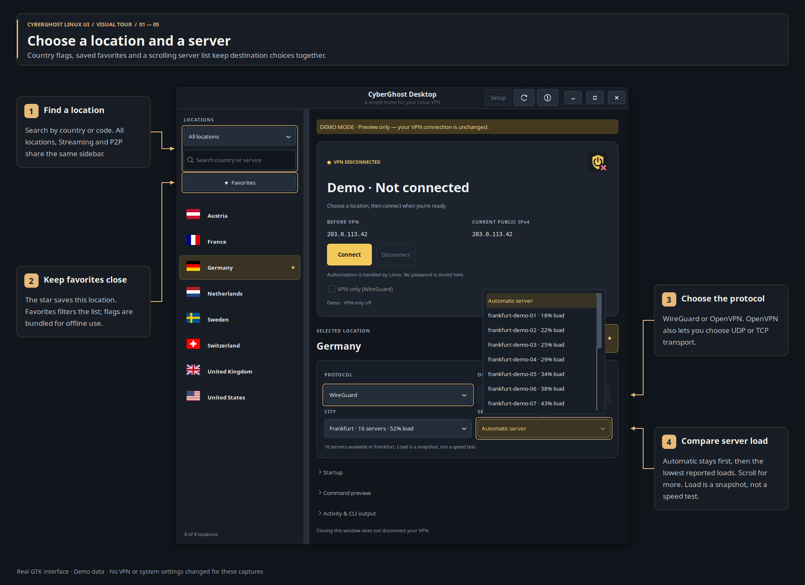
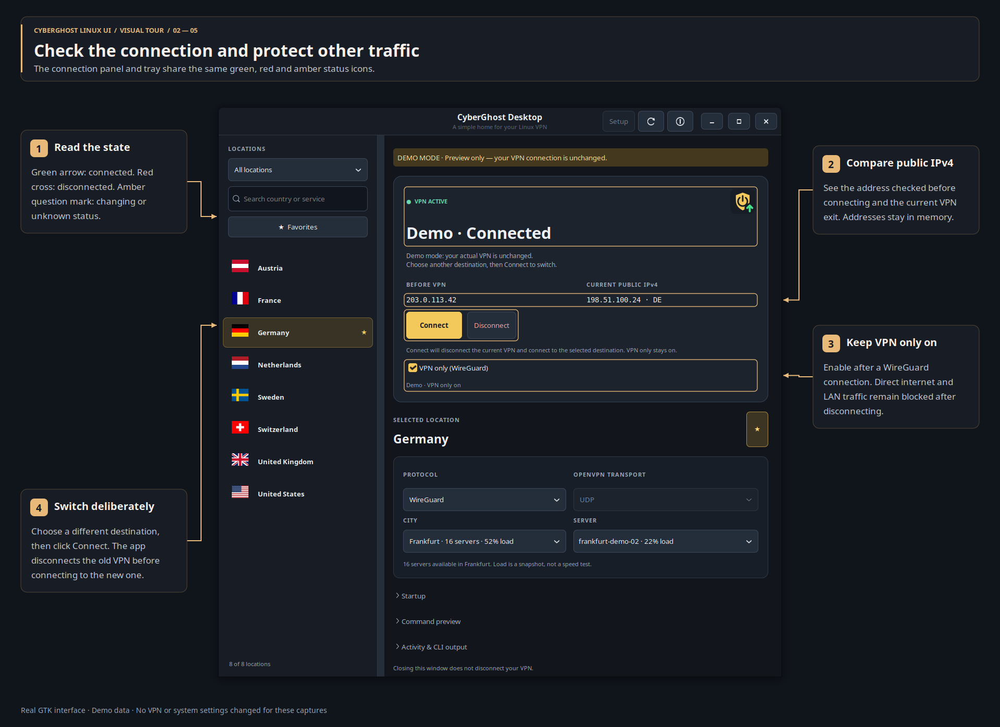
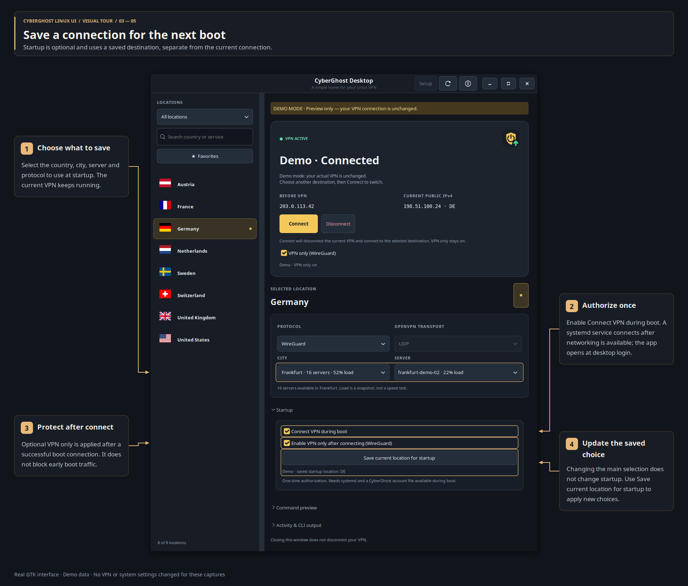
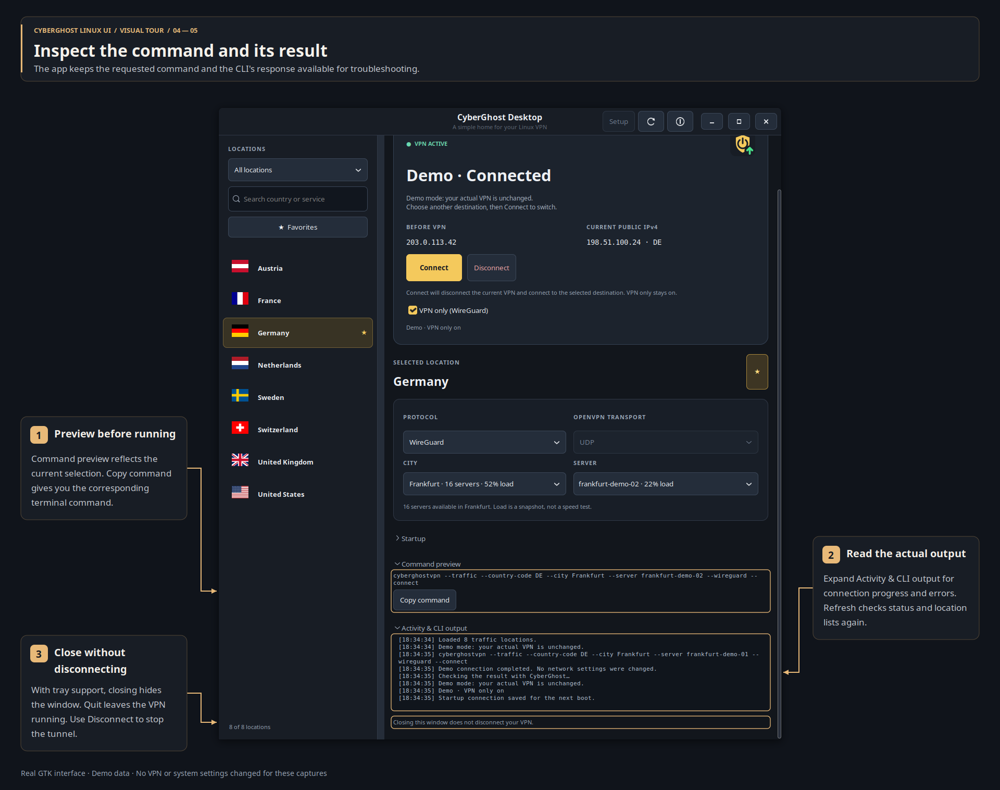
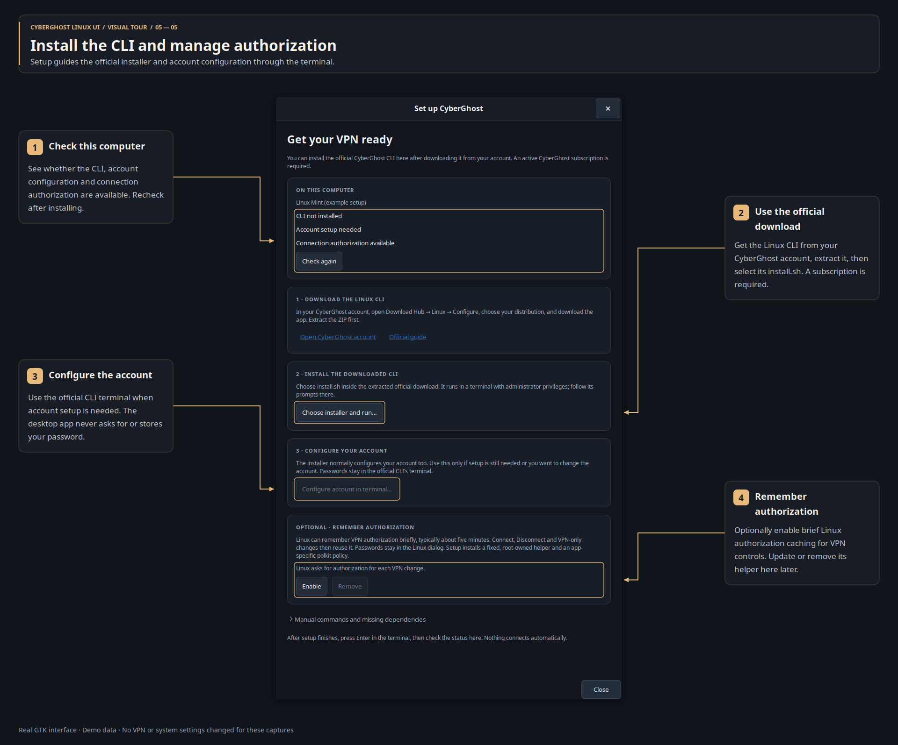

# CyberGhost Linux UI visual tour

Choose a VPN destination, check its connection, and manage protection and startup
from a native Linux desktop window. This tour uses the same numbered amber
callouts as the Eclipse tour, applied to the real GTK interface.

All screenshots use demo data: example addresses, servers and setup state.
Capturing them does not connect a VPN, change firewall rules or install software.
Open any image to read it at full size.

- [Locations and servers](#choose-a-location-and-a-server)
- [Connection and VPN-only protection](#check-the-connection-and-protect-other-traffic)
- [Startup](#save-a-connection-for-the-next-boot)
- [Commands and activity](#inspect-the-command-and-its-result)
- [CLI setup and authorization](#install-the-cli-and-manage-authorization)

## Choose a location and a server

Search by country name or country code. The location menu switches between
**All locations**, **Streaming** and **P2P / Torrent**. Flags are stored with the
app, so they remain available offline. Use the star beside **Selected location**
to save a favorite, then **Favorites** to filter the sidebar.

Choose **WireGuard** or **OpenVPN**; the latter also offers UDP/TCP transport.
Leave the city and server on **Automatic**, or choose them individually. The
server picker scrolls within a compact menu. Automatic stays at the top,
followed by the lowest reported loads; unknown loads come last. A lower load
means less reported server utilization, but it is not a speed or latency test.

The list shows when servers are loading or refreshing. Cached choices remain
visible during refresh. After a protected disconnect, reconnecting allows a
deferred list request to finish. Selecting a location does not connect by itself.

[Using the app](../README.md#using-the-app)

## Check the connection and protect other traffic

The panel and optional tray share the app shield: a **green arrow** means
connected, a **red cross** means disconnected, and an **amber question mark**
means a connection change is underway or status is unknown. Text accompanies the
icon, so the state does not rely on color alone.

**Before VPN** shows the public IPv4 address checked while disconnected;
**Current public IPv4** shows the latest check. If the VPN was already connected
when the app opened, the previous address remains unknown. These addresses stay
in memory.

Enable **VPN only (WireGuard)** after connecting to block direct internet and
LAN traffic outside the tunnel. Protection remains on after **Disconnect** or
**Quit**, until disabled or rebooted. You can reconnect or change WireGuard
servers while it remains enabled.

To switch servers, select a new destination and click **Connect**. The app stops
and verifies the old connection before starting the new one. Changing the
selection alone leaves the current VPN running.

[VPN-only protection](../README.md#optional-wireguard-kill-switch) ·
[Server changes and authorization](../README.md#server-changes-and-authorization)

## Save a connection for the next boot

Choose the destination and protocol, then expand **Startup**. Enable **Connect
VPN during boot** and authorize the setup once. The systemd service uses that
saved connection after networking becomes available, and the desktop app opens
when you sign in.

The optional startup protection is applied **after** a successful WireGuard
connection; it does not block early boot traffic. Changing the main location
controls later does not alter the saved boot profile. Click **Save current
location for startup** to update it.

Startup needs systemd and a CyberGhost account configuration accessible before
desktop login. Saving or disabling startup does not disconnect the current VPN.

[Connect during boot](../README.md#connect-during-boot)

## Inspect the command and its result

**Command preview** reflects the current selection. **Copy command** copies its
terminal command. Expand **Activity & CLI output** to read connection progress,
status checks and errors; use the refresh button or **F5** to check again.

With tray support, closing the window hides it; use the tray to reopen it or
disconnect. **Quit** leaves the VPN running. **Disconnect** explicitly stops the
tunnel. **Ctrl+F** focuses location search and **Ctrl+Q** quits the app.

[Using the app](../README.md#using-the-app)

## Install the CLI and manage authorization

Open **Setup** in the header. It checks the official CLI, account configuration
and Linux authorization support. Download the Linux CLI from your CyberGhost
account, extract it, and choose its **install.sh**. The official installer runs
in a terminal. An active CyberGhost subscription is required.

If account setup is needed, use **Configure account in terminal** after
installing. Credentials stay in the official CLI terminal; the desktop app does
not request or store your password. **Check again** detects completed setup
without restarting the app.

**Optional · Remember authorization** enables brief Linux authorization caching
for Connect, Disconnect and VPN-only changes, typically around five minutes.
It installs an app-specific helper and policy. This section also offers
**Update** when that helper is outdated and **Remove** to disable caching.

[First-run CLI setup](../README.md#first-run-cli-setup) ·
[Authorization caching](../README.md#server-changes-and-authorization)

---

[Back to README](../README.md) ·
[Recreate the screenshots](implementation.md#documentation-captures)
